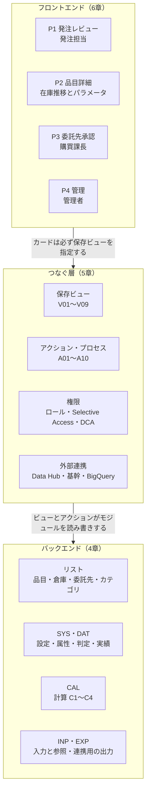
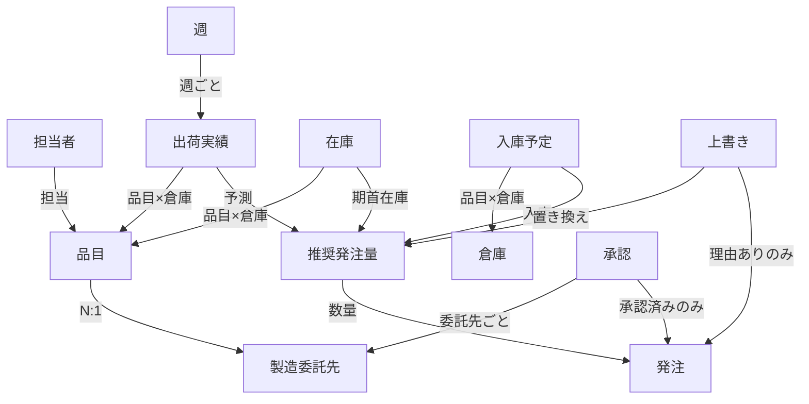
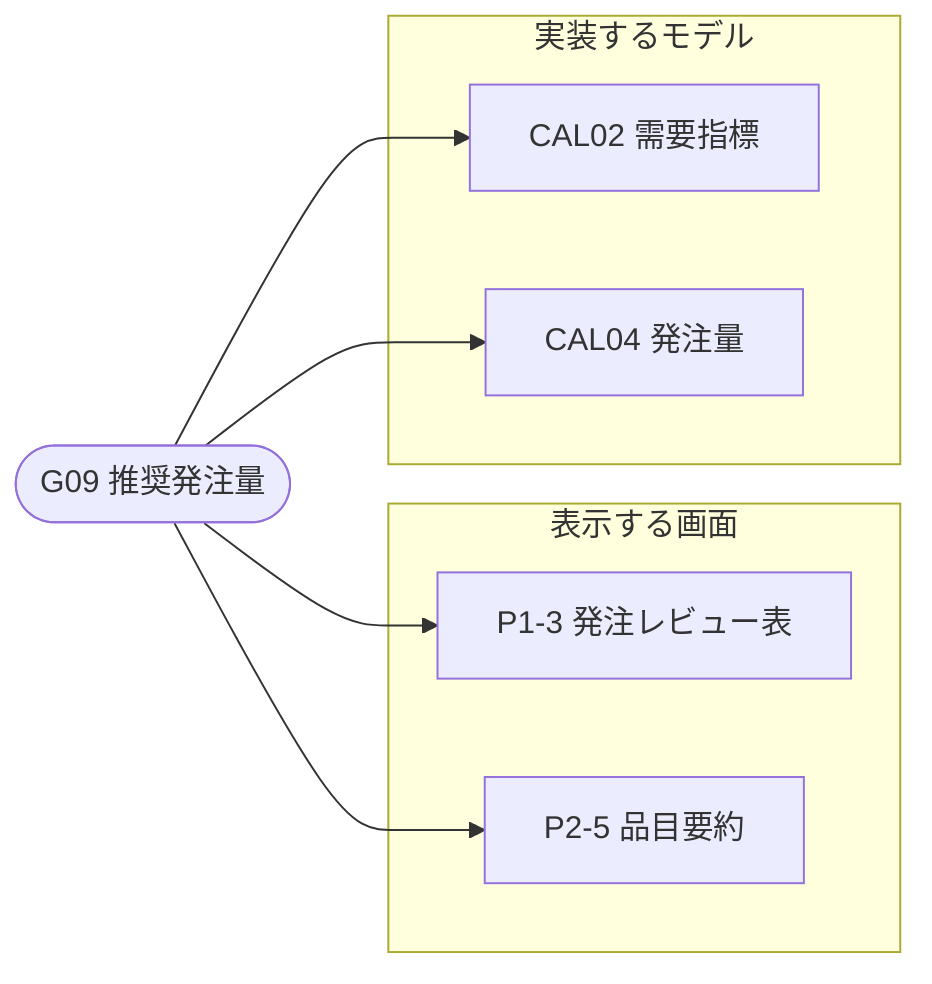
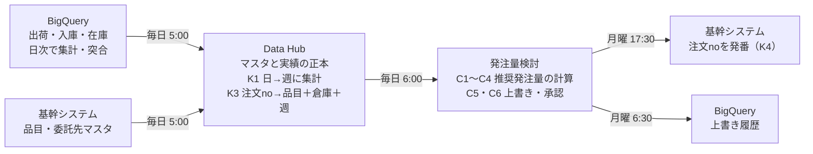
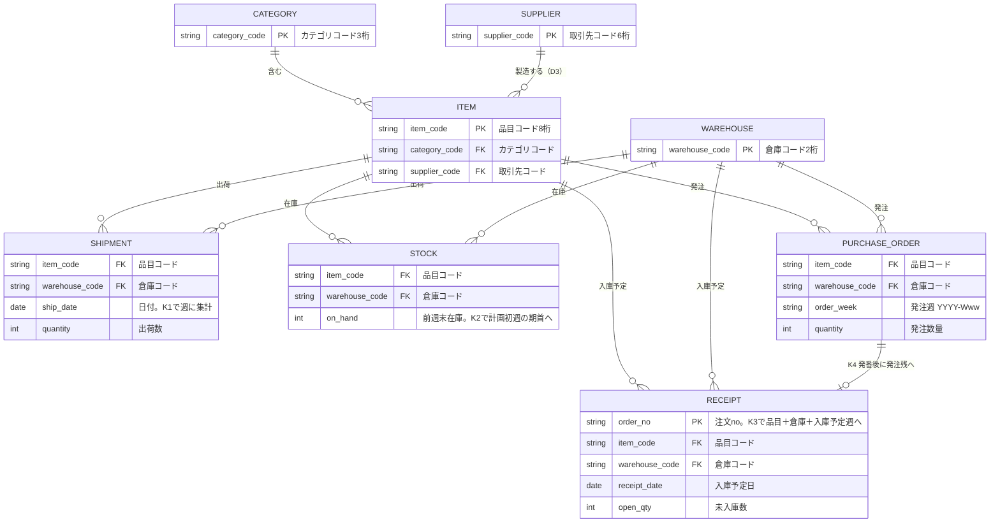
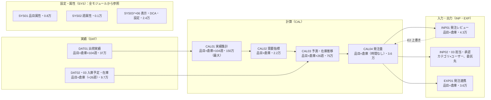
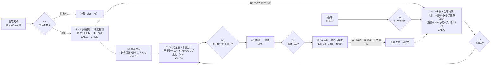

# 発注量検討モデル 設計書 v42（概要・要件・基本設計）

## はじめに（この設計書の使い方）

この設計書は、発注量検討モデルを「何のために、何を、どう作るか」を、業務の人と開発者が同じ資料で確かめるためのものである。v42では、図をすべてMermaid（文字で書く図）に、台帳と画面イメージを表にしたので、Excel・Markdown・Mermaidが使える環境ならどこでも同じものを作り、直せる。書き方の決まりは「設計書ルール v42」（rules.md）にある。

| 立場 | 読む章 | 読んだ後にすること |
| --- | --- | --- |
| 業務担当・購買課長 | 1 → 2 → 6 → 4.5 | 要件（FR）とP1の画面イメージに違和感があれば、その箇所にコメントする。計算例の推奨発注量（300）が業務の感覚と合うかを確かめる |
| 開発者 | 台帳 → 3 → 4 → 5 → 6 → 11 → 10 | 11章の順に構築し、各段の完了条件（テスト）を満たしてから次へ進む。ライン項目のNotesの先頭に設計書のID（C1、B3など）を書く |
| レビューする人 | 台帳（点検） → 8 → 9 → 7 → 4.3 | 設計書ルールの「提出前チェック」で判定する。点検0件、判断の前提とトリガー、例外の理由、3年後のセル数を確かめる |
| 追加開発を検討する人 | 台帳（つながり表） → 8 | 変える概念の行を見て、表示する画面と実装するモデル、崩れる前提（D）を見積もりの範囲にする |
| 次のシステムを作る人 | 1 → 2 → 3 → 4.3 → 8 | Anaplanに依存しない業務ルールとデータの約束（キー、時刻、責任者）を引き継ぐ |

## この資料の読み方（3層構造）

この資料は、業務の人向けの概要・要件（1・2章）と、開発者向けの基本設計（3〜11章）をまとめたものである。Anaplanの仕組みを、利用者が触る「フロントエンド」、データと計算の「バックエンド」、その間をつなぐ「つなぐ層」の3層に分けて書く。画面はつなぐ層（保存ビュー）を通してだけモジュールに触れる。

## 台帳（業務の概念・画面・モデルのつながり）

業務の概念ごとに、それを表示する画面（カード）と、実装するモデル（リスト・モジュール）を1行にまとめた。この「つながり表」と「概念の関係表」が台帳の正本で、下の2つのMermaid図は台帳から書き起こしたものである。表はそのままExcelに貼り付けて、フィルターや件数の確認に使える。

### つながり表（概念 → 画面・モデル）

| 概念ID | 概念 | 説明 | 表示する画面（6.2） | 実装するモデル（4.1・4.4） | 画面の数 | モデルの数 | 判定 |
| --- | --- | --- | --- | --- | --- | --- | --- |
| G01 | 担当者 | 発注担当・課長 | P4-1、P4-4 | リスト ユーザー、INP02、SYS03 | 2 | 3 | OK |
| G02 | 品目 | PB品目 1,200 | P1-3、P2-1、P2-4 | リスト 品目、リスト 品目カテゴリ、SYS01 | 3 | 3 | OK |
| G03 | 製造委託先 | 15社 | P3-1 | リスト 製造委託先、SYS06 | 1 | 2 | OK |
| G04 | 倉庫 | 3拠点 | P1-1、P2-1 | リスト 倉庫 | 2 | 1 | OK |
| G05 | 週 | 実績104・計画26 | P2-3 | SYS02、SYS05 | 1 | 2 | OK |
| G06 | 出荷実績 | 品目×倉庫×週 | P1-3、P2-2、P4-2 | DAT01、CAL01、CAL02 | 3 | 3 | OK |
| G07 | 在庫 | 前週末 | P2-2、P2-3、P4-2 | DAT03、CAL03 | 3 | 2 | OK |
| G08 | 入庫予定 | 発注残 | P2-3、P4-2 | DAT02、CAL03 | 2 | 2 | OK |
| G09 | 推奨発注量 | 今週分 | P1-3、P2-5 | CAL02、CAL04 | 2 | 2 | OK |
| G10 | 上書き | 理由付き | P1-3 | INP01、SYS04 | 1 | 2 | OK |
| G11 | 承認 | 委託先ごと | P3-1 | INP03、SYS04 | 1 | 2 | OK |
| G12 | 発注 | 基幹へ連携 | P4-3 | EXP01 | 1 | 1 | OK |

### 概念の関係表（概念 → 概念）

| 元 | 先 | 関係（ラベル） |
| --- | --- | --- |
| G01 担当者 | G02 品目 | 担当（カテゴリ単位） |
| G02 品目 | G03 製造委託先 | N:1（D3） |
| G05 週 | G06 出荷実績 | 週ごと |
| G06 出荷実績 | G02 品目 | 品目×倉庫 |
| G07 在庫 | G02 品目 | 品目×倉庫 |
| G08 入庫予定 | G04 倉庫 | 品目×倉庫 |
| G06 出荷実績 | G09 推奨発注量 | 予測 |
| G07 在庫 | G09 推奨発注量 | 期首在庫 |
| G08 入庫予定 | G09 推奨発注量 | 入庫 |
| G10 上書き | G09 推奨発注量 | 置き換え |
| G11 承認 | G03 製造委託先 | 委託先ごと |
| G09 推奨発注量 | G12 発注 | 数量 |
| G10 上書き | G12 発注 | 理由ありのみ |
| G11 承認 | G12 発注 | 承認済みのみ |

### 概念図（関係表から作成）

業務の概念は品目を中心につながり、出荷・在庫・入庫予定の3つが推奨発注量に集まる。

### つながり図の例（G09 推奨発注量）

つながり表の1行を図にしたもの。追加開発で「推奨発注量の計算を変える」場合、影響を受けるのは画面2つとモデル2つである。他の概念も、つながり表の行を同じ形に書き換えれば図にできる。

### 点検

| 点検項目 | 件数 | 確かめ方 |
| --- | --- | --- |
| つながりのない画面（6.2のカードで、つながり表に出てこないもの） | 0件 | 6.2のカード15件のうち、データを表示する12件が、つながり表の「表示する画面」にすべて出てくる（テキストとページ移動のカード3件は対象外） |
| つながりのないモデル（4.1のリスト・4.4のモジュールで、つながり表に出てこないもの） | 0件 | リスト5件・モジュール17件が、つながり表の「実装するモデル」にすべて出てくる |
| 画面に出ない概念 | 0件 | 「画面の数」が0の行がない |
| モデルのない概念 | 0件 | 「モデルの数」が0の行がない |

Excelで点検する場合は、カード・リスト・モジュールの一覧を別のシートに置き、つながり表の文字列を `COUNTIF(範囲,"*P1-3*")` のように数えると、0件の対象が見つかる。Markdownの場合は `python tools/check_design.py` で同じ点検ができる。

## 1. 概要

製造委託先への週次の発注量を、出荷・入庫・在庫の実績から自動で計算する。担当者は推奨値を確認・修正し、課長が承認したものを基幹システムへ送る。計算方法を1つに揃え、担当者ごとの判断のばらつきと作業時間を減らす。

| 項目 | 内容 |
| --- | --- |
| 目的 | 欠品と過剰在庫を減らしながら、発注作業を毎週月曜の1日で終わらせる |
| 対象 | PB品目 1,200 SKU × 倉庫 3拠点、製造委託先 15社 |
| 利用者 | 発注担当 6名（品目カテゴリ別）、購買課長 1名、管理者（社内SE） |
| 頻度 | 週1回（月曜）。実績は毎日更新 |
| 成果物 | 委託先別・品目別・倉庫別の発注数量（注文noは基幹システムで発番） |

業務の流れ（毎週）：

1. 毎日5〜6時：出荷・入庫予定・在庫・品目マスタが自動で更新される。
2. 月曜6時半：前週の上書き内容を履歴として保存し、上書きと承認をリセットする。
3. 月曜9〜16時：発注担当が担当品目の推奨発注量を確認し、必要なら理由を付けて上書きする。
4. 月曜16〜17時：購買課長が委託先ごとに内容を確認して承認する。承認した委託先の品目は変更できなくなる。
5. 月曜17時半：承認済みの発注を基幹システムへ送る。翌日以降、発注残として入庫予定に戻ってくる。

## 2. 要件

### 2.1 機能要件

| ID | 要件 | 利用者 | 実現する場所（6.3で詳細） |
| --- | --- | --- | --- |
| FR-01 | 品目×倉庫ごとの推奨発注量を、毎週月曜9時までに計算する | — | 4章の計算 |
| FR-02 | 発注担当は、担当カテゴリの品目だけを一覧で確認できる | 発注担当 | P1 |
| FR-03 | 推奨発注量を上書きできる。理由のない上書きは発注に反映しない | 発注担当 | P1 |
| FR-04 | 品目ごとに今後26週の在庫推移と、計算に使ったパラメータを確認できる | 発注担当、課長 | P2 |
| FR-05 | 購買課長が委託先ごとに承認できる。承認後はその委託先の品目を変更できない | 購買課長 | P3 |
| FR-06 | 承認済みの発注を月曜17時半に基幹システムへ送る | — | 連携 |
| FR-07 | 上書きの履歴（推奨値・上書き値・理由）を残す | — | 連携 |
| FR-08 | 管理者が、カテゴリごとの担当者を変更できる | 管理者 | P4 |
| FR-09 | 発注対象外の品目は計算せず、画面にも出さない | — | 4章の計算、P1 |

### 2.2 非機能要件

| ID | 要件 | 目標値 |
| --- | --- | --- |
| NFR-01 | 画面の応答 | P1で上書きしてから表示が更新されるまで3秒以内 |
| NFR-02 | 日次取込の完了 | 毎日7時まで（月曜は計算込みで9時までに確定） |
| NFR-03 | 同時利用 | 8名が同時に入力しても NFR-01 を満たす |
| NFR-04 | 権限 | 担当外の品目は書き込めない（表示の絞り込みではなく権限で制御） |
| NFR-05 | 取込失敗時 | 前日のデータで業務を続けられ、画面で失敗が分かる |
| NFR-06 | 履歴 | 上書き履歴をBigQueryに2年以上保存 |
| NFR-07 | 拡張 | 3年後の件数（品目1,800、倉庫5）でもNFR-01〜03を満たす |

### 2.3 対象外

原材料の手配、委託先の生産能力の調整、価格交渉、発注書の送付（基幹システムの機能）。

### 2.4 用語

| 用語 | 意味 |
| --- | --- |
| 推奨発注量 | このモデルが計算する、今週発注すべき量 |
| 最終発注量 | 推奨発注量、または理由付きの上書き値。基幹へ送る量 |
| リードタイム（LT） | 発注してから倉庫に入るまでの週数 |
| ロット・MOQ | 発注の単位と、最小発注量 |
| 発注残 | 発注済みでまだ入庫していない量（入庫予定） |
| 計画初週 | 今週。計画は今週から26週分 |
| ページ・カード | Anaplanの画面（ページ）と、その中の部品（表、グラフ、ボタンなど） |
| モジュール・ライン項目 | Anaplanの計算表と、その行（項目） |
| 保存ビュー | モジュールの見せ方（行・列・絞り込み）を名前を付けて保存したもの。画面とモジュールをつなぐ |
| Mermaid | 文字で書く図の記法。GitHubやMarkdownの編集ソフトで図として表示される |

## 3. 全体像とデータ

### 3.1 システム構成とタイミング

実績とマスタは毎朝5時にData Hubへ入り、6時に発注量検討モデルへ配られる。発注量検討モデルからは、月曜6時半に上書き履歴をBigQueryへ、17時半に承認済みの発注を基幹へ送る。矢印のラベルは連携の時刻。

### 3.2 データのつながりとキー

計画はすべて「品目コード＋倉庫コード（＋週）」で行う。注文noで入ってくる発注残だけは、Data Hubでこのキーに変換する（K3）。品目と委託先が多対1であること（1品目1委託先）が、設計判断D3の前提である。

ER図の読み方：`||--o{` は「1対多」（左の1件に右が0件以上）、`||--o|` は「1対0か1」。PKはその表のキー、FKは他の表のキーを持つ列。

| 変換点 | データ | 受け取るキー | 計画で使うキー | ルール | 場所 |
| --- | --- | --- | --- | --- | --- |
| K1 | 出荷実績 | 品目＋倉庫＋日 | 品目＋倉庫＋週 | 月曜始まりの週に合計 | Data Hub |
| K2 | 在庫 | 品目＋倉庫（毎日の最新値） | 品目＋倉庫 | 前週末の在庫を計画初週の期首にする | DAT03、CAL03 |
| K3 | 入庫・発注残 | 注文no | 品目＋倉庫＋入庫予定週 | 未入庫数を入庫予定週で合計。0の週も送る | Data Hub |
| K4 | 承認済み発注 | — | 品目＋倉庫＋週 | 基幹が注文noを発番し、発注残として戻る | 基幹システム |

利用者（Anaplanのユーザーリスト）はメールアドレスで識別し、品目カテゴリとは担当割当（INP02）でつながる。

## 4. バックエンド（リスト・モジュール）

### 4.1 リスト

| リスト | 種類 | コード | 現在 | 3年後 | 親・トップレベル | 本番リスト | 更新 |
| --- | --- | --- | --- | --- | --- | --- | --- |
| 品目カテゴリ | 階層（上位） | カテゴリコード（3桁） | 40 | 50 | — | × | A01 |
| 品目 | 階層（最下位） | 品目コード（8桁） | 1,200 | 1,800 | 品目カテゴリ | ○ | A01（廃番品は削除せず発注対象?をFALSEに） |
| 倉庫 | フラット | 倉庫コード（2桁） | 3 | 5 | トップレベル「全倉庫」（④の合計に必要） | × | 管理者が手動 |
| 製造委託先 | フラット | 取引先コード（6桁） | 15 | 20 | — | ○ | A01 |
| ユーザー | Anaplan標準 | メールアドレス | 8 | 10 | — | — | 管理者 |
| 時間 | 週次（月曜始まり、4月始まりの年度） | — | 130週 | — | — | — | モデル設定 |

### 4.2 モジュール構造

実績（DAT）から計算（CAL01→CAL04）、入力・出力（INP・EXP）へ一方向に流れる。例外はINP01とCAL04の相互参照（E2）だけ。時間を持つのは実績とCAL01・CAL03だけで、発注量以降は時間なし（D9）。

次元表（モジュールごとの次元と時間。●が次元）：

| モジュール | 品目 | カテゴリ | 倉庫 | 委託先 | ユーザー | 時間 | ライン項目数 | セル数（現在） |
| --- | --- | --- | --- | --- | --- | --- | --- | --- |
| SYS01 品目属性 | ● |  |  |  |  | — | 7 | 8,400 |
| SYS02 週属性 |  |  |  |  |  | 全130週 | 7 | 910 |
| SYS03 表示対象 | ● |  |  |  | ● | — | 1 | 9,600 |
| SYS04 入力制御 | ● |  | ● |  |  | — | 4 | 14,400 |
| SYS05 システム設定 |  |  |  |  |  | — | 4 | 4 |
| SYS06 委託先制御 |  |  |  | ● |  | — | 1 | 15 |
| DAT01 出荷実績 | ● |  | ● |  |  | 104週 | 1 | 374,400 |
| DAT02 入庫予定 | ● |  | ● |  |  | 26週 | 1 | 93,600 |
| DAT03 在庫 | ● |  | ● |  |  | — | 1 | 3,600 |
| CAL01 実績集計 | ● |  | ● |  |  | 104週 | 4 | 1,497,600 |
| CAL02 需要指標 | ● |  | ● |  |  | — | 6 | 21,600 |
| CAL03 予測・在庫推移 | ● |  | ● |  |  | 26週 | 8 | 748,800 |
| CAL04 発注量 | ● |  | ● |  |  | — | 10 | 36,000 |
| INP01 発注レビュー | ● |  | ● |  |  | — | 12 | 43,200 |
| INP02 担当割当 |  | ● |  |  | ● | — | 1 | 320 |
| INP03 委託先承認 |  |  |  | ● |  | — | 5 | 75 |
| EXP01 発注連携 | ● |  | ● |  |  | — | 10 | 36,000 |

### 4.3 計算フロー・複雑さ・分岐

推奨発注量は、リードタイムが過ぎた週の予定在庫が目標在庫（安全在庫＋1週分）を下回る分を、ロットで切り上げて決める。計算するのは今週の1つだけ（D9）。図のひし形は分岐（B）、丸数字は複雑さの所在。算式の詳細は4.4、数値の例は4.5。

| 番号 | 場所 | 何が複雑か | なぜ必要か | テスト |
| --- | --- | --- | --- | --- |
| ① | C1（CAL01→CAL02） | 直近N週だけの合計。時間のあるCAL01で週フラグに該当する週だけ値を残し、時間のないCAL02から時間サマリー（合計）で受ける | 直近N週の平均・標準偏差を、業務が変えられる週数で出すため | T-01、T-11 |
| ② | C3（CAL03） | 前週の期末在庫を繰り越す。計画初週だけ前週末在庫を使う | 26週の在庫推移を出すため | T-01 |
| ③ | C4（CAL03→CAL04） | 品目ごとに違うLTの週の期末在庫を、時間のないCAL04で受ける。CAL03で該当週だけ値を残し、時間サマリー（合計）で1つにする | 発注量を時間なしにしたため（D9） | T-01、T-11 |
| ④ | C6（CAL04→INP03） | 品目の属性（委託先）で集計し、倉庫はトップレベルで合計する | 委託先単位で承認するため。D3の前提 | T-09 |

分岐は、条件が決まる最も粗い粒度で1回だけ判定する。発注量を時間なしにしたことで、B3・B4・B5は品目×倉庫×週（93,600回）ではなく品目×倉庫（3,600回）で判定する。

| 分岐 | 条件 | 判定の粒度（回数） | 判定する場所 | 効く場所 | 位置 | テスト |
| --- | --- | --- | --- | --- | --- | --- |
| B1 | 発注対象外 | 品目（1,200） | SYS01 | CAL02・CAL03・CAL04の先頭、SYS03 | 入口 | T-04 |
| B2 | 計画初週か | 週（130） | SYS02 | CAL03 期首在庫 | C3の入口 | T-01 |
| B3 | 前年実績があるか | 品目×倉庫（3,600） | CAL02 | CAL03 季節係数 | C3の前 | T-02 |
| B4 | 不足分が0か | 品目×倉庫（3,600） | CAL04 | 推奨発注量 | C4の中 | T-03 |
| B5 | 理由付きの上書きか | 品目×倉庫（3,600） | CAL04（入力はINP01） | 最終発注量 | 最後 | T-05、T-06 |
| B6 | 承認済みか | 委託先（15） | INP03 | SYS04（DCA）、EXP01 | 最後 | T-08、T-09 |
| B7 | LTの週か | 品目×倉庫×週（93,600） | CAL03 | LT到達週の期末在庫 | C3→C4 | T-11 |
| B8 | 表示対象か | 品目×ユーザー（9,600） | SYS03 | V01のフィルター、A10 | 画面の入口 | T-07 |

B7だけは週単位の判定が残る。品目ごとにLTが違うため、品目×倉庫×週で判定する必要がある。

### 4.4 モジュール仕様

17モジュール・83ライン項目の構築指示。数式は疑似数式で書き、構築後はモデル（Blueprint）を正とする。区分は「取込」「入力」「計算」「参照（他モジュールの値をそのまま出す）」「固定」の5種類。

疑似数式の読み方：`モジュール.項目` は他モジュールの項目。`[LOOKUP: X]` はXが指す項目の値を取る。`[SUM: X]` はXでまとめて合計する。時間のあるモジュールの項目を時間のないモジュールから参照すると、時間サマリー（合計・最後の期間・いずれか）の値が返る。週の前後比較は、週の開始日（START）で行う。

#### 設定・属性（SYS）

| モジュール（次元・時間） | ライン項目 | 型 | 区分 | 疑似数式・取込元 | 時間サマリー・備考 |
| --- | --- | --- | --- | --- | --- |
| SYS05 システム設定（なし） | 現在週 | 期間（週） | 取込 | A05 IMP_現在週 | 毎週月曜に1週進む |
| SYS05 | 計画週数 | 数値 | 固定 | 26 |  |
| SYS05 | 移動平均週数 | 数値 | 固定 | 8 | 業務で調整するパラメータ |
| SYS05 | ばらつき週数 | 数値 | 固定 | 26 | 同上 |
| SYS02 週属性（時間：週・全130週） | 計画初週? | Boolean | 計算 | 週 = SYS05.現在週 | B2 |
| SYS02 | 計画週番号 | 数値 | 計算 | 週 ≥ 現在週 のとき（週 − 現在週）の週数 + 1、それ以外は0 | 今週＝1 |
| SYS02 | 計画週? | Boolean | 計算 | 計画週番号 ≥ 1 AND 計画週番号 ≤ SYS05.計画週数 |  |
| SYS02 | 直近8週? | Boolean | 計算 | 週 < 現在週 AND 週 ≥ 現在週 − SYS05.移動平均週数 | ① |
| SYS02 | 直近26週? | Boolean | 計算 | 週 < 現在週 AND 週 ≥ 現在週 − SYS05.ばらつき週数 | ① |
| SYS02 | 直近52週? | Boolean | 計算 | 週 < 現在週 AND 週 ≥ 現在週 − 52 | ① |
| SYS02 | 前年同週 | 期間（週） | 計算 | 週の52週前 |  |
| SYS01 品目属性（品目） | 品目カテゴリ | リスト | 取込 | A01 IMP_品目 |  |
| SYS01 | 委託先 | リスト | 取込 | A01 | D3：1品目1委託先 |
| SYS01 | LT週 | 数値 | 取込 | A01 | 1〜26の範囲（T-11） |
| SYS01 | ロット | 数値 | 取込 | A01 |  |
| SYS01 | MOQ | 数値 | 取込 | A01 |  |
| SYS01 | 安全係数 | 数値 | 取込 | A01 |  |
| SYS01 | 発注対象? | Boolean | 取込 | A01 | B1。品目単位で1回だけ判定 |
| SYS03 表示対象（品目×ユーザー） | 表示対象? | Boolean | 計算 | INP02.担当?[LOOKUP: SYS01.品目カテゴリ] AND SYS01.発注対象? | B8。P1のユーザー別フィルター、A10の元 |
| SYS04 入力制御（品目×倉庫） | 上書き入力可? | Boolean | 計算 | SYS01.発注対象? AND NOT INP01.承認済み? | INP01のDCA（書込） |
| SYS04 | クリア用_FALSE | Boolean | 固定 | FALSE | A06の取込元 |
| SYS04 | クリア用_0 | 数値 | 固定 | 0 | 同上 |
| SYS04 | クリア用_空 | テキスト | 固定 | 空 | 同上 |
| SYS06 委託先制御（委託先） | クリア用_FALSE | Boolean | 固定 | FALSE | A07の取込元 |

#### 実績（DAT）

| モジュール（次元・時間） | ライン項目 | 型 | 区分 | 取込元 | 時間サマリー・備考 |
| --- | --- | --- | --- | --- | --- |
| DAT01 出荷実績（品目×倉庫、週・実績104週） | 出荷数 | 数値 | 取込 | A02 IMP_出荷 | 合計 |
| DAT02 入庫予定（品目×倉庫、週・計画26週） | 入庫予定数 | 数値 | 取込 | A03 IMP_入庫予定 | 合計。全件洗い替え（0も送る） |
| DAT03 在庫（品目×倉庫） | 前週末在庫 | 数値 | 取込 | A04 IMP_在庫 |  |

#### 計算（CAL）

| モジュール（次元・時間） | ライン項目 | 型 | 疑似数式 | 時間サマリー | 備考 |
| --- | --- | --- | --- | --- | --- |
| CAL01 実績集計（品目×倉庫、週・実績104週） | 直近8週出荷 | 数値 | IF SYS02.直近8週? THEN DAT01.出荷数 ELSE 0 | 合計 | ① 旗で絞って時間サマリーで受ける |
| CAL01 | 直近26週出荷 | 数値 | IF SYS02.直近26週? THEN DAT01.出荷数 ELSE 0 | 合計 | ① |
| CAL01 | 直近26週出荷二乗 | 数値 | IF SYS02.直近26週? THEN POWER(DAT01.出荷数, 2) ELSE 0 | 合計 | ① 標準偏差用 |
| CAL01 | 直近52週出荷 | 数値 | IF SYS02.直近52週? THEN DAT01.出荷数 ELSE 0 | 合計 | ① |
| CAL02 需要指標（品目×倉庫） | 直近8週平均出荷 | 数値 | IF SYS01.発注対象? THEN CAL01.直近8週出荷 / SYS05.移動平均週数 ELSE 0 | — | C1。B1で入口を止める |
| CAL02 | 直近26週平均 | 数値 | CAL01.直近26週出荷 / SYS05.ばらつき週数 | — |  |
| CAL02 | 出荷標準偏差 | 数値 | SQRT(MAX(0, CAL01.直近26週出荷二乗 / SYS05.ばらつき週数 − POWER(直近26週平均, 2))) | — |  |
| CAL02 | 直近52週平均出荷 | 数値 | CAL01.直近52週出荷 / 52 | — | 季節係数の分母 |
| CAL02 | 前年実績あり? | Boolean | 直近52週平均出荷 > 0 | — | B3。品目×倉庫で1回だけ判定 |
| CAL02 | 安全在庫 | 数値 | SYS01.安全係数 × 出荷標準偏差 × SQRT(SYS01.LT週) | — | C2 |
| CAL03 予測・在庫推移（品目×倉庫、週・計画26週） | 前年同週出荷 | 数値 | DAT01.出荷数[LOOKUP: SYS02.前年同週] | 合計 |  |
| CAL03 | 季節係数 | 数値 | IF CAL02.前年実績あり? THEN 前年同週出荷 / CAL02.直近52週平均出荷 ELSE 1 | なし | B3 |
| CAL03 | 予測出荷 | 数値 | IF SYS01.発注対象? THEN CAL02.直近8週平均出荷 × 季節係数 ELSE 0 | 合計 | C3 |
| CAL03 | 入庫予定 | 数値 | DAT02.入庫予定数 | 合計 |  |
| CAL03 | 期首在庫 | 数値 | IF SYS02.計画初週? THEN DAT03.前週末在庫 ELSE PREVIOUS(期末在庫) | 最初の期間 | ② B2 |
| CAL03 | 期末在庫 | 数値 | 期首在庫 + 入庫予定 − 予測出荷 | 最後の期間 | ②。推奨発注は含まない |
| CAL03 | 欠品リスク? | Boolean | 期末在庫 < CAL02.安全在庫 | いずれか（Any） | 26週のどこかで下回ればTRUE |
| CAL03 | LT到達週の期末在庫 | 数値 | IF SYS02.計画週番号 = SYS01.LT週 THEN 期末在庫 ELSE 0 | 合計 | ③ B7。1週だけ値が入る |
| CAL04 発注量（品目×倉庫） | 目標在庫 | 数値 | CAL02.安全在庫 + CAL02.直近8週平均出荷 | — | 安全在庫＋1週分 |
| CAL04 | LT後予定在庫 | 数値 | CAL03.LT到達週の期末在庫 | — | ③ 時間サマリー（合計）で1つの値になる |
| CAL04 | 不足分 | 数値 | IF SYS01.発注対象? THEN MAX(0, 目標在庫 − LT後予定在庫) ELSE 0 | — | C4 |
| CAL04 | ロット切上げ量 | 数値 | ROUNDUP(不足分 / SYS01.ロット, 0) × SYS01.ロット | — | D7 |
| CAL04 | 推奨発注量 | 数値 | IF ロット切上げ量 = 0 THEN 0 ELSE MAX(SYS01.MOQ, ロット切上げ量) | — | B4 |
| CAL04 | 理由未入力? | Boolean | INP01.上書き? AND ISBLANK(INP01.上書き理由) | — | FR-03 |
| CAL04 | 最終発注量 | 数値 | IF INP01.上書き? AND NOT 理由未入力? THEN INP01.上書き値 ELSE 推奨発注量 | — | B5 |
| CAL04 | 発注あり件数 | 数値 | IF 最終発注量 > 0 THEN 1 ELSE 0 | — | INP03で合計 |
| CAL04 | 上書き件数 | 数値 | IF INP01.上書き? THEN 1 ELSE 0 | — | 同上 |
| CAL04 | 理由未入力件数 | 数値 | IF 理由未入力? THEN 1 ELSE 0 | — | 同上 |

#### 入力・出力（INP・EXP）

入力モジュールは「入力」と「参照」だけを持ち、計算しない（D12）。画面の1つの表は1つのモジュールしか表示できないため、推奨値と上書きを並べて見せる参照項目をここに置く。

| モジュール（次元） | ライン項目 | 型 | 区分 | 疑似数式 | 備考 |
| --- | --- | --- | --- | --- | --- |
| INP01 発注レビュー（品目×倉庫） | 委託先 | リスト | 参照 | SYS01.委託先 |  |
| INP01 | 直近8週平均出荷 | 数値 | 参照 | CAL02.直近8週平均出荷 |  |
| INP01 | 安全在庫 | 数値 | 参照 | CAL02.安全在庫 |  |
| INP01 | LT後予定在庫 | 数値 | 参照 | CAL04.LT後予定在庫 |  |
| INP01 | 推奨発注量 | 数値 | 参照 | CAL04.推奨発注量 |  |
| INP01 | 欠品リスク? | Boolean | 参照 | CAL03.欠品リスク? | 条件付き書式（赤） |
| INP01 | 上書き? | Boolean | 入力 | — | DCA：SYS04.上書き入力可? |
| INP01 | 上書き値 | 数値 | 入力 | — | 同上 |
| INP01 | 上書き理由 | テキスト | 入力 | — | 同上 |
| INP01 | 理由未入力? | Boolean | 参照 | CAL04.理由未入力? | 条件付き書式（黄） |
| INP01 | 最終発注量 | 数値 | 参照 | CAL04.最終発注量 |  |
| INP01 | 承認済み? | Boolean | 参照 | INP03.承認?[LOOKUP: SYS01.委託先] | B6 |
| INP02 担当割当（品目カテゴリ×ユーザー） | 担当? | Boolean | 入力 | — | 管理者がP4で入力 |
| INP03 委託先承認（委託先） | 発注数量合計 | 数値 | 参照 | CAL04.最終発注量[SUM: SYS01.委託先] | ④ 倉庫は合計される |
| INP03 | 発注品目数 | 数値 | 参照 | CAL04.発注あり件数[SUM: SYS01.委託先] | ④ |
| INP03 | 上書き件数 | 数値 | 参照 | CAL04.上書き件数[SUM: SYS01.委託先] | ④ |
| INP03 | 理由未入力件数 | 数値 | 参照 | CAL04.理由未入力件数[SUM: SYS01.委託先] | ④ 条件付き書式（黄） |
| INP03 | 承認? | Boolean | 入力 | — | 購買課長のみ書込（ロール） |
| EXP01 発注連携（品目×倉庫） | 連携対象? | Boolean | 計算 | INP01.承認済み? AND CAL04.最終発注量 > 0 | V07のフィルター |
| EXP01 | 履歴対象? | Boolean | 計算 | INP01.上書き? | V08のフィルター |
| EXP01 | 委託先コード | テキスト | 計算 | CODE(SYS01.委託先) | 6桁 |
| EXP01 | 品目コード | テキスト | 計算 | CODE(ITEM(品目)) | 8桁 |
| EXP01 | 倉庫コード | テキスト | 計算 | CODE(ITEM(倉庫)) | 2桁 |
| EXP01 | 発注週 | テキスト | 計算 | SYS05.現在週 を YYYY-Www 形式に |  |
| EXP01 | 推奨発注量 | 数値 | 参照 | CAL04.推奨発注量 | 履歴用 |
| EXP01 | 発注数量 | 数値 | 参照 | CAL04.最終発注量 |  |
| EXP01 | 上書き値 | 数値 | 参照 | INP01.上書き値 | 履歴用 |
| EXP01 | 上書き理由 | テキスト | 参照 | INP01.上書き理由 | 履歴用 |

### 4.5 計算例（品目A001 × 倉庫01）

数式の意味を数値で追うための例で、テストT-01の期待値を兼ねる。推奨発注量は、LT後の予定在庫（750）が目標在庫（842.95）を約93下回るため、ロット100に切り上げた後、MOQ 300が適用されて300になる。

| 入力 | 値 |
| --- | --- |
| LT週・ロット・MOQ・安全係数 | 3週・100・300・1.65 |
| 直近8週の出荷合計 | 4,000 |
| 直近26週の出荷：平均・二乗の平均 | 480・244,800 |
| 直近52週の平均出荷 | 500 |
| 前年同週の出荷（計画1〜4週目） | 各週550 |
| 前週末在庫 | 1,800 |
| 入庫予定（計画2週目） | 600 |

| ステップ | 計算 | 結果 |
| --- | --- | --- |
| C1 直近8週平均出荷 | 4,000 ÷ 8 | 500 |
| C1 出荷標準偏差 | √(244,800 − 480²) ＝ √14,400 | 120 |
| C2 安全在庫 | 1.65 × 120 × √3 | 342.95 |
| C3 季節係数・予測出荷 | 550 ÷ 500 ＝ 1.10、500 × 1.10 | 各週550 |

| 計画週 | 期首在庫 | 入庫予定 | 予測出荷 | 期末在庫 | 欠品リスク（安全在庫342.95未満） |
| --- | --- | --- | --- | --- | --- |
| 1（今週） | 1,800 | 0 | 550 | 1,250 | — |
| 2 | 1,250 | 600 | 550 | 1,300 | — |
| 3（＝LT） | 1,300 | 0 | 550 | 750 | — |
| 4 | 750 | 0 | 550 | 200 | 該当 |

| ステップ | 計算 | 結果 |
| --- | --- | --- |
| C4 目標在庫 | 342.95 + 500 | 842.95 |
| C4 LT後予定在庫 | 計画週番号3の期末在庫 | 750 |
| C4 不足分 | 842.95 − 750 | 92.95 |
| C4 ロット切上げ量 | ROUNDUP(92.95 ÷ 100) × 100 | 100 |
| C4 推奨発注量 | MOQ 300 > 100 のため | 300 |
| C5 最終発注量（上書きなし） | 推奨発注量 | 300 |
| C5 最終発注量（上書き400、理由あり） | 上書き値 | 400 |
| C5 最終発注量（上書き400、理由なし） | 推奨発注量のまま。理由未入力?がTRUE | 300 |

注意：在庫推移（C3）には今週の推奨発注を含めない。計画4週目の欠品リスクは「今週発注しなければ」という警告で、今週300を発注すれば4週目に入庫して解消する見込みである。

## 5. つなぐ層（保存ビュー・アクション・権限・連携）

画面のカード、取込、出力は、すべて名前付きの保存ビューを通してモジュールに触れる。モジュールの既定ビューを画面や取込に直接使わない（列の追加や並べ替えで画面が壊れるため）。

### 5.1 保存ビュー

| ID・名前 | モジュール | 行 | 列 | ページ（選択） | フィルター | 使う場所 |
| --- | --- | --- | --- | --- | --- | --- |
| V01 V_INP01_レビュー | INP01 | 品目 | ライン項目（12） | 倉庫 | SYS03.表示対象?（ユーザー別、1本） | P1-3 |
| V02 V_CAL03_在庫推移 | CAL03 | ライン項目（入庫予定、予測出荷、期末在庫） | 週（計画26週） | 品目、倉庫 | なし | P2-2、P2-3 |
| V03 V_SYS01_パラメータ | SYS01 | ライン項目（LT週、ロット、MOQ、安全係数） | — | 品目 | なし | P2-4 |
| V04 V_INP01_品目要約 | INP01 | ライン項目（安全在庫、LT後予定在庫、推奨、最終） | — | 品目、倉庫 | なし | P2-5 |
| V05 V_INP03_承認 | INP03 | 委託先 | ライン項目（5） | — | なし | P3-1 |
| V06 V_INP02_担当 | INP02 | 品目カテゴリ | ユーザー | — | なし | P4-1 |
| V07 V_EXP01_発注 | EXP01 | 品目 × 倉庫（入れ子） | 委託先コード、品目コード、倉庫コード、発注週、発注数量 | — | 連携対象? | A08 |
| V08 V_EXP01_上書き履歴 | EXP01 | 品目 × 倉庫（入れ子） | 発注週、品目コード、倉庫コード、推奨発注量、上書き値、上書き理由、発注数量 | — | 履歴対象? | A09 |
| V09 V_SYS03_アクセス | SYS03 | 品目 | ユーザー | — | なし | A10 |

フィルターのルール：表示を絞るBooleanは1本にまとめ、SYSモジュールに置く。ユーザーごとに変わる絞り込みは、ユーザーを次元に持つSYS03で行う。フィルターは見やすさのためのもので、書込みの制限は5.3の権限で行う。

### 5.2 アクションとプロセス

| ID・名前 | 種類 | 取込元 → 先 | 処理 | 実行 |
| --- | --- | --- | --- | --- |
| A01 IMP_品目 | インポート | Data Hub V_HUB_品目 → 品目リスト、SYS01 | 品目コードで照合。新規は追加、既存は属性を更新 | P_日次取込 |
| A02 IMP_出荷 | インポート | Data Hub V_HUB_出荷週 → DAT01 | 品目コード＋倉庫コード＋週で照合 | P_日次取込 |
| A03 IMP_入庫予定 | インポート | Data Hub V_HUB_入庫予定 → DAT02 | 計画26週の全件（0を含む）で洗い替え | P_日次取込 |
| A04 IMP_在庫 | インポート | Data Hub V_HUB_在庫 → DAT03 | 品目コード＋倉庫コードで照合 | P_日次取込 |
| A05 IMP_現在週 | インポート | Data Hub V_HUB_現在週 → SYS05.現在週 | 今週を設定 | P_週次切替 |
| A06 CLR_上書き | インポート | SYS04 のクリア用項目 → INP01 の上書き?・上書き値・上書き理由 | FALSE・0・空で上書き | P_週次切替 |
| A07 CLR_承認 | インポート | SYS06.クリア用_FALSE → INP03.承認? | FALSEで上書き | P_週次切替 |
| A08 EXP_発注 | エクスポート | V07 → 基幹システム | CSV出力、REST APIで送信 | P_発注連携 |
| A09 EXP_上書き履歴 | エクスポート | V08 → BigQuery | CSV出力、前週分を保存 | P_週次切替 |
| A10 IMP_選択的アクセス | インポート | V09 → 品目リストのSelective Access | 表示対象? = TRUE の品目に書込権限 | P_日次取込、P4ボタン |

| プロセス | 中身（実行順） | 起動 | 失敗時 |
| --- | --- | --- | --- |
| P_日次取込 | A01 → A10 → A02 → A03 → A04 | CloudWorks、毎日6:00 | 社内SEに通知。前日データで業務継続、P1に警告 |
| P_週次切替 | A09 → A05 → A06 → A07 | CloudWorks、月曜6:30 | A09が失敗したら後続を止める（履歴を消さないため） |
| P_発注連携 | A08 | CloudWorks、月曜17:30。P4ボタンで再送 | 社内SEが再送 |

順番の理由：A01（品目）を先に入れないと、新品目の実績が取り込めない。A09（履歴保存）はA06（上書きのクリア）より必ず先に実行する。

### 5.3 権限（3段で制御）

| 段 | 何を制御するか | 設定 |
| --- | --- | --- |
| ロール | ページとモジュールの閲覧・編集 | 発注担当：P1・P2、INP01を編集、INP03は閲覧のみ。購買課長：P1〜P3、INP03を編集。管理者：全ページ、INP02を編集 |
| Selective Access | リストの項目単位の書込み | 品目リスト：発注担当は担当カテゴリの品目だけ書込み可（A10で毎日更新）。課長・管理者は全品目 |
| DCA（動的セルアクセス） | 条件によるセル単位の書込み | INP01の上書き?・上書き値・上書き理由：SYS04.上書き入力可? が TRUE のときだけ書込み可（承認後はロック） |

### 5.4 連携ファイル仕様

| ファイル | 方向 | 列（順） | 形式 | 件数の目安 |
| --- | --- | --- | --- | --- |
| 発注連携 | Anaplan → 基幹 | 委託先コード（6桁）、品目コード（8桁）、倉庫コード（2桁）、発注週（YYYY-Www）、発注数量（整数） | CSV、UTF-8、見出しあり | 週あたり最大3,600行 |
| 上書き履歴 | Anaplan → BigQuery | 発注週、品目コード、倉庫コード、推奨発注量、上書き値、上書き理由、発注数量 | 同上 | 週あたり数十行 |

Data Hubから受け取るデータのキーと変換は3章、取込の照合キーは5.2を参照。照合できない行（未登録の品目など）は取り込まずにログに残し、日次で社内SEが確認する。

## 6. フロントエンド（ページ・カード）

ページは4つ。1ページ＝1つの業務目的・1つのロールで作り、編集できるのは入力モジュール（INP）の入力項目だけ。発注担当が最も長く使うのはP1で、推奨値と上書きを同じ行で比べられるようにする。

### 6.1 P1の画面イメージ

P1 発注量レビュー（ワークシート）は、上から次の順にカードを置く。

| 位置 | カード | 表示 |
| --- | --- | --- |
| 上部の右 | P1-1 文脈セレクター | 倉庫：01 ▼ |
| 上部 | P1-2 テキスト | 赤い行から確認し、上書きするときは理由を入力する |
| 中央 | P1-3 グリッド（V01） | 下の表 |
| 下部の右 | P1-4 ボタン | 品目詳細へ → |

P1-3 グリッドの例（A001は4.5の計算例と同じ値）。【入力】の列だけが編集でき、承認後はロックされる。

| 品目 | 委託先 | 8週平均 | 安全在庫 | LT後在庫 | 推奨 | 上書き?【入力】 | 上書き値【入力】 | 理由【入力】 | 最終 | 書式 |
| --- | --- | --- | --- | --- | --- | --- | --- | --- | --- | --- |
| A001 | S01 | 500 | 343 | 750 | 300 | ✓ | 400 | 販促予定 | 400 | 行を赤（欠品リスク?） |
| A002 | S01 | 120 | 80 | 600 | 0 |  |  |  | 0 | なし |
| A003 | S02 | 80 | 60 | 90 | 100 | ✓ | 200 | （空） | 100 | 理由のセルを黄（理由未入力?） |

書式の意味：赤い行＝欠品リスク?（26週のどこかで安全在庫を下回る）。黄色のセル＝理由未入力?（上書きが発注に反映されず、最終は推奨のまま）。

### 6.2 ページとカード

| カード | 種類 | 表示元 | 編集できる項目 | 書式・動作 |
| --- | --- | --- | --- | --- |
| **P1 発注量レビュー**（ワークシート、発注担当、月曜9〜16時） |  |  |  |  |
| P1-1 | 文脈セレクター | 倉庫リスト | — | P1-3に効く |
| P1-2 | テキスト | 操作の手順 | — | — |
| P1-3 | グリッド | V01 | 上書き?、上書き値、上書き理由（承認後はDCAでロック） | 欠品リスク?＝行を赤、理由未入力?＝理由セルを黄 |
| P1-4 | ボタン | ページ移動 | — | P2へ移動 |
| **P2 品目詳細**（ボード、発注担当・課長） |  |  |  |  |
| P2-1 | 文脈セレクター | 品目、倉庫 | — | P2-2〜P2-5に効く |
| P2-2 | チャート（折れ線） | V02 | — | 期末在庫と予測出荷の26週推移 |
| P2-3 | グリッド | V02 | なし | 週別の内訳 |
| P2-4 | フィールド | V03 | なし | LT週、ロット、MOQ、安全係数 |
| P2-5 | フィールド | V04 | なし | 安全在庫、LT後予定在庫、推奨、最終 |
| **P3 委託先別承認**（ワークシート、購買課長、月曜16〜17時） |  |  |  |  |
| P3-1 | グリッド | V05 | 承認? | 理由未入力件数が1以上＝黄 |
| P3-2 | テキスト | 承認の手順 | — | 理由未入力のある委託先は担当へ差し戻す |
| **P4 管理**（ボード、管理者） |  |  |  |  |
| P4-1 | グリッド | V06 | 担当? | — |
| P4-2 | ボタン | P_日次取込 | — | 取込の再実行 |
| P4-3 | ボタン | P_発注連携 | — | 基幹への再送 |
| P4-4 | ボタン | A10 | — | 担当変更を書込権限にすぐ反映 |

### 6.3 要件から実装までの対応

| 要件 | ページ・カード | 保存ビュー・アクション | モジュール | テスト |
| --- | --- | --- | --- | --- |
| FR-01 推奨発注量の計算 | — | P_日次取込 | CAL01〜CAL04 | T-01〜T-03、T-11 |
| FR-02 担当品目だけ表示 | P1-3 | V01 | SYS03、INP01 | T-07 |
| FR-03 理由付きの上書き | P1-3 | V01 | INP01、CAL04 | T-05、T-06 |
| FR-04 在庫推移とパラメータ | P2-2〜P2-5 | V02〜V04 | CAL03、SYS01、INP01 | T-01 |
| FR-05 委託先ごとの承認 | P3-1 | V05 | INP03、SYS04 | T-08 |
| FR-06 基幹への連携 | P4-3 | V07、A08 | EXP01 | T-09 |
| FR-07 上書き履歴 | — | V08、A09 | EXP01 | T-10 |
| FR-08 担当割当の変更 | P4-1、P4-4 | V06、V09、A10 | INP02、SYS03 | T-07 |
| FR-09 発注対象外の除外 | P1-3 | V01 | SYS01、SYS03 | T-04 |

## 7. 非機能・性能

モデル全体は約289万セルで、3年後も約720万セルの見込み。最大のCAL01実績集計でも3年後374万セルで、目安（1モジュール1億セル）を大きく下回る。各モジュールのセル数は4.2の次元表にある。

| モジュール | 次元 × 時間 × 項目数 | 現在 | 3年後 |
| --- | --- | --- | --- |
| CAL01 実績集計 | 品目×倉庫 × 104週 × 4 | 150万 | 374万 |
| CAL03 予測・在庫推移 | 品目×倉庫 × 26週 × 8 | 75万 | 187万 |
| DAT01 出荷実績 | 品目×倉庫 × 104週 × 1 | 37万 | 94万 |
| DAT02 入庫予定 | 品目×倉庫 × 26週 × 1 | 9.4万 | 23万 |
| その他13モジュール | 時間なし | 17万 | 41万 |

| 非機能要件 | 設計での対応 | 確認方法 |
| --- | --- | --- |
| NFR-01 画面応答3秒 | P1のグリッドは時間なしのINP01（担当1人あたり約600行）。フィルターはBoolean 1本 | T-12 |
| NFR-02 日次取込7時まで | 取込は5本、入庫予定のみ洗い替え。計算の重いCAL01はフラグとSUMだけ | 構築後に所要時間を記録 |
| NFR-03 同時8名 | 入力セルを品目×倉庫（時間なし）に限定し、入力1回で再計算されるのはCAL04以降 | T-12 |
| NFR-04 担当外は書込不可 | Selective Access（5.3） | T-07 |
| NFR-05 取込失敗時 | プロセスの失敗通知、前日データ継続 | 失敗を模擬して確認 |
| NFR-06 履歴 | A09を週次切替の最初に実行 | T-10 |
| NFR-07 拡張 | 上表の3年後セル数 | 3年後件数のダミーデータで計測 |

エンジンはClassic。充填率が低いのは入庫予定（発注残のある週だけ値が入る）程度で、Polarisに移す理由は小さい。

## 8. 設計判断記録

追加開発で最も作り直しが大きいのはD3（1品目1委託先）。D9（発注量を時間なしにする）は、26週すべてに推奨発注量を出すと、先の週の推奨が前の週の発注を考慮しないという誤りを避けるための判断である。

| ID | 判断 | 検討した他の案 | 理由 | 崩れたら作り直しになる前提 | 見直しトリガー | 作り直しの範囲 |
| --- | --- | --- | --- | --- | --- | --- |
| D1 | 週次で計算する | 日次、月次 | 発注確定が週1回 | 発注確定が週1回 | 委託先が週2回以上の発注を求めたとき | 時間を持つ全モジュール |
| D2 | 品目と倉庫は2つの次元で持つ | 複合リスト | ほぼ全品目が全倉庫で取扱あり | 取扱率50%以上 | 倉庫が10拠点を超えるとき | CAL・INP・EXP、画面 |
| D3 | 委託先を品目の属性で持つ | 品目×委託先の配分 | 全品目が1社で製造 | 1品目1委託先 | 2社購買を始めるとき | CAL04、INP03（④）、EXP01、連携、P3 |
| D4 | 予測は直近8週平均×季節係数 | PlanIQ、外部予測 | 担当者が根拠を説明できる | 予測方式が単純 | 予測誤差が3か月連続で目標超 | CAL03の予測出荷の入力元のみ |
| D5 | 安全在庫＝安全係数×ばらつき×√LT | 固定日数分 | 欠品許容率で係数を決められる | LTがほぼ一定 | LTのばらつきが大きくなったとき | CAL02の安全在庫のみ |
| D6 | 注文noは基幹で発番 | Anaplanで発番 | 番号の正本を基幹に置く | 基幹の番号体系 | 管理no体系を見直すとき | EXP01、3章のK3・K4 |
| D7 | 推奨発注量を不足分・ロット切上げ量・推奨発注量に分ける | 1本の数式 | 根拠を追え、ルール変更が1項目で済む | なし | — | — |
| D8 | 発注対象外の判定（B1）は品目単位で1回、計算の入口で止める | 途中で判定 | 無駄な計算と意味のない予測値をなくす | 発注対象が品目単位 | 倉庫ごとに発注対象を変えるとき | SYS01→品目×倉庫の判定に |
| D9 | 発注量・上書き・承認は時間なし（今週の1つだけ） | 26週すべてに推奨発注量 | 先の週の推奨は前の週の発注を含まず、意味がない。セル数・DCA・画面も単純になる | 発注判断は今週分だけ | 複数週先の発注計画が必要になったとき | CAL03に計画発注を足し、CAL04を時間ありに |
| D10 | 実績の統計（平均・標準偏差）はAnaplanで計算する | BigQueryで計算して受け取る | 移動平均週数などを業務が調整でき、計算の根拠が画面で追える | 実績が104週分で足りる | CAL01が1,000万セルを超えるとき | CAL01・CAL02をBigQueryに移す |
| D11 | 上書き履歴は週次クリアの前にBigQueryへ出す | Anaplanに週別で保存 | 履歴のためにINP01へ時間を足すと、セル数と入力の扱いが複雑になる | BigQueryが使える | — | — |
| D12 | 入力モジュールは入力と参照だけを持ち、計算しない | 入力と計算を同じモジュールに | 画面の表は1モジュールしか出せないため参照は置くが、計算の場所はCALに限定する | — | — | — |
| D13 | 書込みはSelective Access、表示はユーザー別フィルターで分ける | フィルターだけで制御 | フィルターは利用者が外せるため、権限の代わりにならない | 担当がカテゴリ単位 | 担当が品目単位で変わる運用になったとき | SYS03、A10 |
| D14 | 図はMermaid、台帳と画面イメージは表で書く（v42） | 専用ツールの動的な図 | ExcelやMarkdownの環境でも作れ、直せる。GitHubでそのまま図になる | 図の箱が12個程度に収まる | 図が読めないほど大きくなったとき | 台帳、図をすべて作り直す |

## 9. 意図的な例外

| ID | 箇所 | 外れている標準 | 理由 | 解消する条件 |
| --- | --- | --- | --- | --- |
| E1 | 出荷実績から最終発注量までの依存の深さ（約10段） | 主要KPIまで7段以内 | D7（分割）とD9（時間なし化）で段数が増えたが、1段ずつ追える | 性能測定で問題が出たとき |
| E2 | INP01とCAL04がモジュール単位で互いに参照 | DISCOの一方向 | INP01は推奨値を表示し、CAL04は上書きを使う。ライン項目単位の循環はない | 画面が別モジュールを並べて表示できるようになったとき |
| E3 | SYS04・SYS06のクリア用の固定値 | SYSには属性と判定だけを置く | 値のクリアはインポートでしかできないため | — |

## 10. テスト観点と受入基準

T-01はモデル全体の結合確認、T-02〜T-11は分岐（B）と複雑さ（①〜④）の境目、T-12は性能。すべて合格で受入とする。

| ID | 対象 | 条件 | 期待結果 | 要件 |
| --- | --- | --- | --- | --- |
| T-01 | C1〜C5 | 4.5の計算例の入力 | 4.5の各ステップの結果と一致（推奨発注量300） | FR-01 |
| T-02 | B3 | 直近52週の出荷がない品目 | 季節係数1、予測出荷＝直近8週平均出荷 | FR-01 |
| T-03 | B4 | 在庫が十分で不足分0 | 推奨発注量0（MOQは適用しない） | FR-01 |
| T-04 | B1 | 発注対象?＝FALSE の品目 | 推奨発注量0、P1に表示されない | FR-09 |
| T-05 | B5 | 上書き400・理由あり | 最終発注量400、上書き件数1 | FR-03 |
| T-06 | B5 | 上書き400・理由なし | 最終発注量300、理由未入力?がTRUEでP1の理由セルが黄色、P3の理由未入力件数1 | FR-03 |
| T-07 | B8、権限 | 担当外カテゴリの品目 | P1に表示されず、他の方法で開いても書き込めない | FR-02、NFR-04 |
| T-08 | B6、DCA | 委託先を承認 | その委託先の品目の上書き3項目が書込み不可 | FR-05 |
| T-09 | ④、A08 | 承認済み委託先と未承認委託先が混在 | 連携ファイルは承認済みかつ最終発注量>0の行だけ、列順・桁数が5.4どおり | FR-06 |
| T-10 | A09→A06 | 週次切替を実行 | 前週の上書きがBigQueryに出力された後で、上書きと承認がクリアされる | FR-07 |
| T-11 | ①③、B7 | LT週＝1と26、年の境目の週、53週ある年 | LT後予定在庫が正しい週の期末在庫になる。直近N週の判定がずれない | FR-01 |
| T-12 | 性能 | 担当1人分（約600行）の表示と上書き、8名同時 | 3秒以内 | NFR-01、03 |

## 11. 構築の順番と完了条件

依存の向き（リスト → 設定・属性 → 実績 → 計算 → 入力・出力 → つなぐ層 → 画面 → 権限）に沿って作る。全段共通で、ライン項目のNotesの先頭に設計書のID（C1、B3、①など）を書く。

| 順 | 作るもの | 参照する章 | 完了条件 |
| --- | --- | --- | --- |
| 1 | リスト：品目カテゴリ、品目（親＝カテゴリ）、倉庫（トップレベル「全倉庫」あり）、製造委託先 | 4.1 | コードがData Hubと一致し、件数が一致する |
| 2 | SYS05 システム設定、SYS02 週属性 | 4.4 | 現在週を変えると、計画初週?・直近8週? などが正しい週に立つ |
| 3 | DAT01〜03 と A01〜A05、P_日次取込 | 4.4、5.2 | 取込件数と合計がBigQueryの集計と一致する |
| 4 | SYS01、INP02、SYS03 | 4.4 | 担当割当を変えると表示対象?が変わる |
| 5 | CAL01、CAL02 | 4.4、4.5 | T-01の直近8週平均出荷500、標準偏差120、安全在庫342.95 |
| 6 | CAL03 | 4.4、4.5 | T-01の在庫推移表と一致、T-02、T-11 |
| 7 | CAL04 | 4.4、4.5 | T-01の推奨発注量300、T-03、T-04 |
| 8 | INP01、INP03、SYS04、SYS06、EXP01 | 4.4 | T-05、T-06 |
| 9 | 保存ビュー V01〜V09 | 5.1 | 名前・行・列・フィルターが5.1どおり |
| 10 | A06〜A10、P_週次切替、P_発注連携 | 5.2 | T-09、T-10 |
| 11 | ページ P1〜P4 とカード | 6章 | 6.2のカードがすべて配置され、業務担当が操作できる |
| 12 | ロール、Selective Access、DCA | 5.3 | T-07、T-08 |
| 13 | 性能測定と仕上げ | 7章 | T-12。全ライン項目にNotes。Blueprintを出力して保存 |
